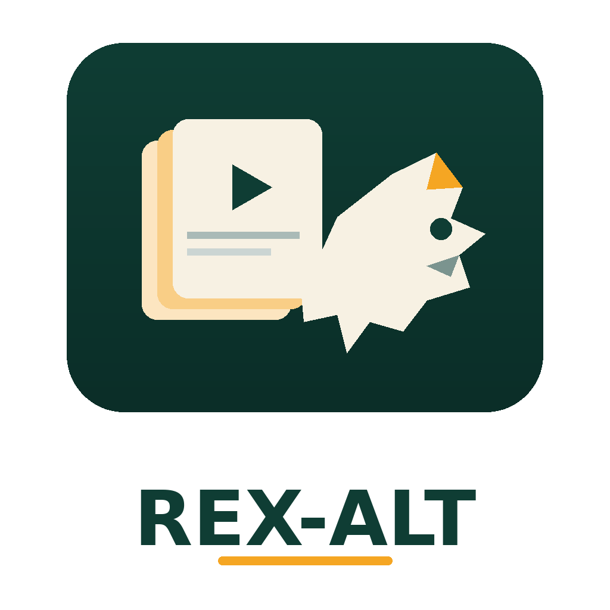

# Rex-Alt

Rex-Alt is a small, self-contained Docker add-on that publishes the media already sitting on an **Altmount** WebDAV share to **REX** (and therefore Plex) as a brand-new, independent REX source. It enumerates Altmount over WebDAV, looks up artwork and titles from TMDB, probes each file with `ffprobe` over an HTTP Range request, and pushes only metadata to REX. REX then fetches the actual media bytes directly from Altmount.

It is deliberately additive: **Zurg stays untouched and remains a REX source.** Nothing under `/opt/media-stack` or `/opt/altmount` is modified. All of Rex-Alt's own state (a small SQLite database) lives in its own Docker volume.

## What it is / what it is not

**It is:**

- A REX *source add-on*, registered under the stable source name `rex-alt`.
- A publisher of two new libraries: **Altmount Movies** (directory `movies`) and **Altmount TV** (directory `tv`).
- A metadata-only bridge: WebDAV `PROPFIND` for enumeration, TMDB for display metadata, `ffprobe` over HTTP Range for `media_info`, and the REX source/feed API for delivery.

> The source registers with REX using mount `/altmount`, so its libraries live at `/altmount/movies` and `/altmount/tv`, separate from Zurg's libraries under REX's default `/mnt/rex`. The item paths pushed to the feed stay `movies/...` and `tv/...`.

**It is not:**

- **Not a replacement for Zurg.** Zurg continues to feed REX exactly as before; this is a second source alongside it.
- **Not a media store or downloader.** No media bytes are copied, mounted or written by this container. Its volume holds only SQLite metadata.
- **Not an Altmount configuration tool.** It does not change Altmount or the media stack; it only reads Altmount's WebDAV share.
- **Not an API-key integration.** Enumeration uses **WebDAV with Basic auth only** — the Altmount API key does **not** work for enumeration.
- **Not a delete enabler.** Media deletion on REX must be turned **off** before this source is registered (see prerequisites and [Safety](#resource-and-safety-notes)).

## Architecture (text diagram)

```
  Plex clients
       |
       | play bytes
       v
  +-------------------+       feeds        +-----------------------------+
  | REX               |<-------------------| rex-alt (this add-on)       |
  | source: rex-alt   |  metadata + ids    |  - enumerate WebDAV         |
  | source: zurg      |  (source/feed API) |  - TMDB lookup (cache)      |
  | (untouched)       |                    |  - ffprobe over Range       |
  +---------+---------+                    |  - SQLite state + admin API |
            |                             +--------------+--------------+
            | bytes fetched directly                     |
            | from Altmount WebDAV                       | reads only
            v                                            v
  +-------------------+                        +------------------------+
  | Altmount WebDAV   |<------------------------| /webdav/movies/,       |
  | Basic auth        |   PROPFIND + Range     | /webdav/tv/            |
  +-------------------+                        +------------------------+
```

The rex-alt container talks to REX on `REX_URL`, to Altmount on `ALTMOUNT_WEBDAV_URL`, and to TMDB. Its admin API listens on `APP_PORT` (default `9982`) and is intended for the LAN only.

## Prerequisites

1. **REX is reachable** from the host where this container runs. You need `REX_URL` (for example `http://10.77.77.2:32400`) and a username/password that REX accepts for a new source (`REX_SOURCE_USER` / `REX_SOURCE_PASSWORD`). REX must be running a build that understands source registration and the feed API.

2. **Altmount WebDAV credentials.** You need the WebDAV base URL **with a trailing `/webdav/`**, for example `http://10.77.77.49:8090/webdav/`, plus the Basic-auth username/password (`ALTMOUNT_WEBDAV_USER` / `ALTMOUNT_WEBDAV_PASSWORD`).
   - The trailing `/webdav/` is **required**; `http://host:8090` or `http://host:8090/webdav` will be rejected.
   - Use WebDAV Basic auth, **not** an Altmount API key: the API key does not work for enumeration and the add-on uses WebDAV only.
   - Never put credentials in the URL; keep them in their own variables.

3. **A TMDB credential.** Either a v4 read-access token (`TMDB_READ_ACCESS_TOKEN`, preferred) or a v3 API key (`TMDB_API_KEY`). One is enough. This supplies titles, summaries, dates, posters and backdrops.

4. **Docker with Compose** on the host, with outbound HTTP from the container to REX, Altmount and TMDB. The published image is multi-arch (`linux/amd64`, `linux/arm64`).

5. **REX media deletion must be OFF (one-time).** This is the one change outside `/opt/rex-alt`, and it must be done **before** the `rex-alt` source is registered.
   - **Why:** with media deletion enabled, REX forwards a Plex client's delete for a source item as an HTTP `DELETE` to that source's URL — here, a WebDAV `DELETE` against Altmount. Turning the preference off makes REX refuse such deletes with `403` and never send the WebDAV `DELETE`. Zurg already refuses deletes for its `__magic__` files with a `403`, so this does not change practical behaviour for the existing Zurg-fed items.
   - **How (UI):** in REX, go to **Settings → Library → Allow media deletion** and make sure it is **unchecked/off**.
   - **How (API):** issue `PUT /:/prefs?allowMediaDeletion=0` against REX and confirm the stored value is `0`, for example:

     ```bash
     curl -sS -u "$REX_ADMIN_USER:$REX_ADMIN_PASSWORD" \
       -X PUT "$REX_URL/:/prefs?allowMediaDeletion=0"
     # Then read it back and confirm value="0":
     curl -sS -u "$REX_ADMIN_USER:$REX_ADMIN_PASSWORD" \
       "$REX_URL/:/prefs?allowMediaDeletion"
     ```

     (`REX_ADMIN_USER` / `REX_ADMIN_PASSWORD` are the REX admin credentials you already use; they are not rex-alt settings.)

   > The live REX in this deployment already has `allowMediaDeletion=0` applied. The steps above are for any other operator deploying this add-on.

## Step 1 — Create `.env`

```bash
cd /opt/rex-alt
cp .env.example .env

# Generate values for the two required secrets:
openssl rand -hex 24      # -> API_TOKEN
openssl rand -base64 32   # -> ENCRYPTION_KEY (base64 of exactly 32 random bytes)
```

Edit `.env` and fill in every blank. The minimum required set is:

- `API_TOKEN` (admin API bearer token, at least 16 characters),
- `ENCRYPTION_KEY` (base64 of exactly 32 bytes),
- `REX_URL` (for example `http://10.77.77.2:32400`),
- `REX_SOURCE_USER` / `REX_SOURCE_PASSWORD`,
- `ALTMOUNT_WEBDAV_URL` (ending in `/webdav/`), `ALTMOUNT_WEBDAV_USER` / `ALTMOUNT_WEBDAV_PASSWORD`,
- `TMDB_READ_ACCESS_TOKEN` or `TMDB_API_KEY`.

`.env` is gitignored — never commit it, and never paste real credentials into documentation, issues or chat.

## Step 2 — Add the compose service

You can either use the provided image-only `/opt/rex-alt/docker-compose.yml` as-is, or copy just this service stanza into your existing compose file (adjust port, volume and `env_file` paths for that project):

```yaml
services:
  rex-alt:
    image: ghcr.io/leleasley/rex-alt:v0.1.3
    container_name: rex-alt
    restart: unless-stopped
    env_file: .env
    ports: ["9982:9982"]
    volumes: ["rex-alt-data:/data"]
    pids_limit: 64
    logging:
      driver: json-file
      options:
        max-size: "10m"
        max-file: "3"
    deploy:
      resources:
        limits: { cpus: "0.5", memory: 512M, pids: 64 }
    mem_limit: 512m
    memswap_limit: 512m
    read_only: true
    tmpfs: ["/tmp:size=16m"]
volumes:
  rex-alt-data:
```

Keep it **image-only** (no `build:`). The tag `v0.1.2` will be pinned to a published multi-arch image.

## Step 3 — Start it

```bash
cd /opt/rex-alt
docker compose up -d
docker compose ps
docker compose logs -f rex-alt    # Ctrl-C to stop following
```

Configuration is read only at startup: after changing `.env`, recreate the container with `docker compose up -d`.

## Step 4 — Verify registration and libraries

Check the add-on's liveness endpoint (no token needed):

```bash
curl -sS http://<host>:9982/api/v1/health
# Expected: {"status":"ok","version":"v0.1.3"}
```

Check that REX knows the source (REX answers with the source shape, never credentials):

```bash
curl -sS -u "$REX_SOURCE_USER:$REX_SOURCE_PASSWORD" \
  "$REX_URL/rex/sources/rex-alt"
# Expected: a JSON object with "name": "rex-alt" and the movies/tv directories.
```

Then open Plex and confirm there are **two new libraries**, **Altmount Movies** and **Altmount TV**, under the `rex-alt` source. Registration and the first enumeration happen in the background on startup, so allow a short moment if they are not present immediately.

For richer diagnostics, the token-protected admin endpoints are available:

```bash
curl -sS -H "Authorization: Bearer $API_TOKEN" http://<host>:9982/api/v1/status
curl -sS -H "Authorization: Bearer $API_TOKEN" -X POST http://<host>:9982/api/v1/sync
```

`GET /api/v1/status` reports catalogue counts and the outcome of the last triggered sync; `POST /api/v1/sync` runs one pass right away.

## Step 5 — Small pilot (caps on)

Put limits in `.env` first so only a handful of items are probed and pushed:

```dotenv
SYNC_MAX_MOVIES=10
SYNC_MAX_SERIES=2
REX_SEND_TMDB_IDS=false
PROBE_TIMEOUT=45s
```

```bash
docker compose up -d
curl -sS -H "Authorization: Bearer $API_TOKEN" -X POST http://<host>:9982/api/v1/sync
curl -sS -H "Authorization: Bearer $API_TOKEN" http://<host>:9982/api/v1/status
```

Confirm in Plex that a few items from both libraries appear and that a sample item plays its bytes from Altmount.

**Important — "held" items and first-pass timing.**

- An item whose `ffprobe` result is missing or fails validation is **held invisible**: it is deliberately not pushed to REX until a valid `media_info` probe exists. REX would otherwise keep an unprobed item around forever with no usable metadata, so held items are retried on a later sync instead of appearing broken. Occasional `held` counts in status are expected on a cold library.
- The first full pass over roughly **345 files** takes about **25–45 minutes**, because a cold Altmount file can take **13–24 seconds** to return its first ranged byte. Even with `PROBE_WORKERS=4`, this adds up. Run the first uncapped pass **off-peak** (for example set `SYNC_START_HOUR` to a quiet hour, or simply trigger it overnight).

## Step 6 — Remove the limits

Once the pilot looks right, set the caps back to unlimited and let the full pass run off-peak:

```dotenv
SYNC_MAX_MOVIES=0
SYNC_MAX_SERIES=0
```

```bash
docker compose up -d
curl -sS -H "Authorization: Bearer $API_TOKEN" -X POST http://<host>:9982/api/v1/sync
```

### TMDB ids and merging (`REX_SEND_TMDB_IDS`)

Default **`false`**. With it off, items are sent with full display metadata (title, summary, date, poster/backdrop) but **no** `ids.tmdb` / `ids.imdb`, so AltMount items stay in their own `rex-alt` libraries and do not get merged into existing Zurg-fed rows. With it on, TMDB (or the IMDb fallback) ids and episode ids are attached, which can cause duplicate titles to **merge into the existing Zurg rows** — and ambiguity about which source's bytes play. Keep it off during the pilot; only enable it after observing merge behaviour with a small controlled test if you deliberately want unified entries.

## Configuration

Canonical environment variable names are below (see `.env.example` for the annotated template). Credentials always live in their own variables, never in a URL.

| Variable | Default | Notes |
| --- | --- | --- |
| `API_TOKEN` | *(required)* | Bearer token for the admin API; at least 16 chars. Generate with `openssl rand -hex 24`. |
| `ENCRYPTION_KEY` | *(required)* | Base64 of exactly 32 random bytes. Generate with `openssl rand -base64 32`. |
| `REX_URL` | *(required)* | REX base URL, e.g. `http://10.77.77.2:32400`; http(s), no userinfo. |
| `REX_SOURCE_USER` / `REX_SOURCE_PASSWORD` | empty | Credentials REX accepts for the `rex-alt` source; sent as Basic auth, never in `REX_URL`. |
| `REX_SOURCE_NAME` | `rex-alt` | Stable source name; leave unchanged unless you also update all verification/rollback commands. |
| `REX_SEND_TMDB_IDS` | `false` | Attach TMDB/IMDb ids; off keeps AltMount items separate. See [above](#tmdb-ids-and-merging-rex_send_tmdb_ids). |
| `ALTMOUNT_WEBDAV_URL` | *(required)* | WebDAV base URL ending in `/webdav/`, e.g. `http://10.77.77.49:8090/webdav/`. The trailing slash is mandatory. |
| `ALTMOUNT_WEBDAV_USER` / `ALTMOUNT_WEBDAV_PASSWORD` | empty | WebDAV Basic auth. Shorter aliases `ALTMOUNT_USER` / `ALTMOUNT_PASSWORD` are accepted; the `ALTMOUNT_WEBDAV_*` names win. |
| `TMDB_READ_ACCESS_TOKEN` | empty | v4 read-access token (preferred). Alias `TMDB_READ_TOKEN` accepted when the canonical name is empty. |
| `TMDB_API_KEY` | empty | v3 API key alternative; one TMDB credential is enough. |
| `PUBLIC_URL` | `ALTMOUNT_WEBDAV_URL` | URL REX fetches bytes from, if different; http(s) with a host, no credentials. |
| `APP_PORT` | `9982` | Admin API port. |
| `PROBE_WORKERS` | `4` | Concurrent `ffprobe` workers, 1–8 (hard cap 8). |
| `PROBE_TIMEOUT` | `45s` | Ranged probe timeout; minimum/default 45s for cold Altmount files. |
| `HTTP_TIMEOUT` | `15s` | Per-request HTTP timeout. |
| `SYNC_INTERVAL` | `6h` | Recurring sync interval. |
| `SYNC_START_HOUR` | `-1` | Hour (0–23) to start syncs, or `-1` for no gate. Useful for off-peak full passes. |
| `SYNC_MAX_MOVIES` / `SYNC_MAX_SERIES` | `0` / `0` | Pilot caps; `0` means unlimited. |
| `PUSH_BATCH` | `100` | Items per REX feed POST (REX caps bodies at 16 MiB; large batches are split). |
| `LOG_LEVEL` | `info` | `debug`, `info`, `warn` or `error`. |
| `DATABASE_PATH` | `/data/rex-alt.db` | SQLite path inside the container. |

## Resource and safety notes

- The compose file caps the container at **0.5 CPU and 512 MB** (`cpus: "0.5"`, `mem_limit: 512m`, `memswap_limit: 512m`), with `pids_limit: 64`, a read-only root filesystem and a small `tmpfs` for `/tmp`.
- Container logs are rotated by the `json-file` driver at **10 MB per file, 3 files retained** (`max-size: "10m"`, `max-file: "3"`), so log growth cannot exceed roughly 30 MB per container.
- It stores **no media bytes**: the only persistent state is the SQLite database of ids, paths and cached probe/TMDB metadata. ffprobe children are short-lived and bounded by `PROBE_TIMEOUT`.
- REX feed requests are batched and split to stay under REX's 16 MiB body cap.
- **Deletion safety:** keep REX's `allowMediaDeletion` off. With it on, a Plex delete would be forwarded as a WebDAV `DELETE` to Altmount. With it off, REX returns `403` and sends no `DELETE`.
- Run the first uncapped sync off-peak; cold Altmount starts (13–24 s per file) make it slow but harmless.

## Troubleshooting

- **Container exits immediately at startup.** Config fails closed. Check `docker compose logs rex-alt`: required values (`API_TOKEN`, `ENCRYPTION_KEY`, `REX_URL`, `ALTMOUNT_WEBDAV_URL`), `API_TOKEN` length ≥ 16, `ENCRYPTION_KEY` base64 of 32 bytes, `PROBE_WORKERS` 1–8, `PROBE_TIMEOUT` ≥ 45s.
- **Health works but no source/libraries in REX.** The first pass is asynchronous — check logs and `GET /api/v1/status`, then trigger `POST /api/v1/sync`. Verify `REX_URL` and source credentials and that REX is reachable from inside the container.
- **WebDAV enumeration fails.** Confirm `ALTMOUNT_WEBDAV_URL` ends in `/webdav/` and that `ALTMOUNT_WEBDAV_USER` / `ALTMOUNT_WEBDAV_PASSWORD` are right. The API key cannot be used here.
- **Everything is "held" / items stay invisible.** Held means no valid `media_info`: check that ranged GETs to Altmount return `206` and that Basic auth works, raise `PROBE_TIMEOUT` if cold starts time out, and look for rejected zero-filled/probe validation failures in logs. Items are retried automatically on the next sync.
- **Admin API returns 401/429.** 401 means a missing/incorrect `Authorization: Bearer $API_TOKEN`; 429 is the 120-per-minute per-IP rate limit — wait and retry.
- **Plex shows items but playback fails.** Rex-Alt only publishes metadata; bytes come straight from Altmount WebDAV via REX. Check REX can reach `PUBLIC_URL`/`ALTMOUNT_WEBDAV_URL` and that WebDAV Range requests work.

## Rollback

To fully remove this add-on:

```bash
cd /opt/rex-alt
docker compose down

# Remove the source from REX (two DELETE calls are required to fully remove it):
curl -sS -u "$REX_SOURCE_USER:$REX_SOURCE_PASSWORD" \
  -X DELETE "$REX_URL/rex/sources/rex-alt"
curl -sS -u "$REX_SOURCE_USER:$REX_SOURCE_PASSWORD" \
  -X DELETE "$REX_URL/rex/sources/rex-alt"

# Confirm removal (expect 404):
curl -sS -o /dev/null -w '%{http_code}\n' -u "$REX_SOURCE_USER:$REX_SOURCE_PASSWORD" \
  "$REX_URL/rex/sources/rex-alt"
```

`docker compose down` leaves the named `rex-alt-data` volume (and its SQLite state) in place; add `--volumes` to delete that state too. Removing the source from REX removes the two libraries from Plex. Zurg and the rest of the stack are never touched by this rollback.

## Attribution and licence

The REX client, item mapping and probe/store core are adapted from the [rex-xstream](https://github.com/leleasley/rex-xstream) project. Enumeration targets [AltMount](https://github.com/AltMount)'s WebDAV share. Rex-Alt is released under the **MIT License** — see [LICENSE](LICENSE).
